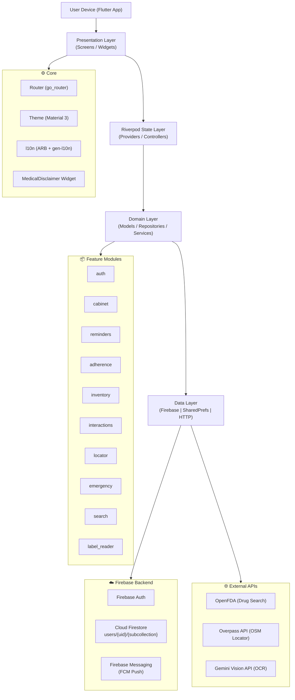

# MyMeds 💊

> **Informational medication-management mobile app** built with Flutter & Firebase.
>
> ⚕️ *This app is for informational purposes only. Always consult a qualified healthcare professional.*

---

## ✨ Feature Overview

| Feature | Status |
|---------|--------|
| 🔑 **Auth** — Email/Password + Google Sign-In | ✅ |
| 💊 **Medication Cabinet** — Add, edit, delete, scan label (OCR) | ✅ |
| 🔔 **Smart Reminders** — Daily, interval, weekday schedules | ✅ |
| 📊 **Adherence Dashboard** — Bar chart, per-medication rates, dose history | ✅ |
| ⚠️ **Expiry & Stock Alerts** — Configurable thresholds, "Attention Needed" panel | ✅ |
| 🔬 **Drug Interaction Checker** — 25 clinical pairs, brand→generic normalization | ✅ |
| 🗺️ **Pharmacy & Clinic Locator** — OpenStreetMap, call, directions | ✅ |
| 🆘 **Emergency Medical Card** — Offline, PDF export, contacts | ✅ |
| 🌍 **Multilingual** — English, Français, العربية (RTL) | ✅ |
| 🌙 **Dark Mode** — Material 3, system-follows | ✅ |
| 📴 **Offline** — Firestore persistence + SharedPreferences caching | ✅ |

---

## 🏗 Architecture



### Layer Responsibilities

| Layer | What lives here |
|-------|----------------|
| **Presentation** | `ConsumerWidget` screens, widgets, forms, state watches |
| **Riverpod State** | `Provider`, `StateNotifierProvider`, `StreamProvider`, `FutureProvider` |
| **Domain** | Pure Dart models, abstract repository interfaces, pure services |
| **Data** | Firebase repos, HTTP clients, SharedPrefs, JSON parsing |

---

## 📁 Folder Structure

```
lib/
├── main.dart                  # Entry point — Firebase init, runApp()
├── app.dart                   # MaterialApp.router + locale + theme wiring
├── core/
│   ├── constants/             # AppConstants (disclaimer text)
│   ├── router/                # GoRouter config, AppRoutes constants
│   ├── theme/                 # AppTheme light/dark (Material 3)
│   └── widgets/               # MedicalDisclaimer, BottomNavShell
├── l10n/
│   ├── app_en.arb             # English strings (template — 250+ keys)
│   ├── app_fr.arb             # French strings
│   ├── app_ar.arb             # Arabic strings (RTL)
│   └── app_localizations*.dart  # Auto-generated (do not edit)
└── features/
    ├── auth/                  # Email/Google auth, user profile
    ├── cabinet/               # Medication list, form, detail, providers
    ├── reminders/             # Reminders, dose logs, scheduling service
    ├── adherence/             # Dashboard, bar chart, dose history
    ├── inventory/             # Expiry/stock classification, attention panel
    ├── interactions/          # Drug interaction check, warning dialog
    ├── locator/               # OpenStreetMap map, places, distance sort
    ├── emergency/             # Emergency card, PDF export, contacts
    ├── search/                # OpenFDA medication search
    ├── label_reader/          # Camera capture, OCR, Gemini label parser
    └── settings/              # Preferences, locale picker, thresholds
```

---

## 🚀 Getting Started

### Prerequisites

| Tool | Version |
|------|---------|
| Flutter SDK | ≥ 3.13 |
| Dart SDK | ≥ 3.1 |
| Android Studio / Xcode | latest stable |
| Firebase CLI | latest |
| FlutterFire CLI | latest |

### 1 — Clone and Install

```bash
git clone <repo-url>
cd my_meds
flutter pub get
```

### 2 — Configure Firebase

```bash
dart pub global activate flutterfire_cli
flutterfire configure
```

This generates `lib/firebase_options.dart`. The placeholder file at `lib/core/config/firebase_options_placeholder.dart` shows the expected shape.

### 3 — Environment Variables

```bash
cp .env.example .env
# Edit .env and fill in Firebase values
```

Or pass them at build time:

```bash
flutter run --dart-define=FIREBASE_API_KEY=xxx --dart-define=FIREBASE_PROJECT_ID=yyy
```

### 4 — Android Permissions

The following are already declared in `android/app/src/main/AndroidManifest.xml`:

- `INTERNET`
- `ACCESS_FINE_LOCATION` / `ACCESS_COARSE_LOCATION` (Locator)
- `RECEIVE_BOOT_COMPLETED`, `SCHEDULE_EXACT_ALARM` (Reminders)

### 5 — Run

```bash
flutter run                        # debug build on connected device
flutter run --release              # release mode (needs signing config)
```

### 6 — Regenerate Localizations (after editing ARB files)

```bash
flutter gen-l10n
```

---

## 🌍 Localization

| Locale | Language | Direction |
|--------|----------|-----------|
| `en` | English | LTR |
| `fr` | Français | LTR |
| `ar` | العربية | **RTL** |

To add a new language:

1. Copy `lib/l10n/app_en.arb` → `lib/l10n/app_<code>.arb`
2. Translate all values
3. Add `Locale('<code>')` to `LocaleRepository.supportedLocales`
4. Run `flutter gen-l10n`

---

## 🧪 Tests

```
flutter test
```

**Test coverage: 118 tests — 100% pass rate**

| Suite | Tests |
|-------|-------|
| `adherence_service_test` | 15 |
| `inventory_service_test` | 12 |
| `local_interaction_repository_test` | 27 |
| `dose_schedule_service_test` | 8 |
| `openfda_medication_repository_test` | 10 |
| `llm_label_parser_service_test` | 10 |
| `overpass_places_repository_test` | 5 |
| `emergency_card_test` | 4 |
| `widget_test` | 1 |

---

## 📸 Screenshots

> _Screenshots taken on Pixel 6 Pro (Android 14) — Dark Mode / Light Mode / Arabic RTL_

| Screen | Light | Dark | Arabic RTL |
|--------|-------|------|-----------|
| Cabinet | `screenshots/cabinet_light.png` | `screenshots/cabinet_dark.png` | `screenshots/cabinet_ar.png` |
| Dashboard | `screenshots/dashboard_light.png` | `screenshots/dashboard_dark.png` | — |
| Reminders | `screenshots/reminders_light.png` | — | — |
| Drug Interactions | `screenshots/interactions_light.png` | — | — |
| Locator Map | `screenshots/locator_map.png` | — | — |
| Emergency Card | `screenshots/emergency_card_light.png` | `screenshots/emergency_card_dark.png` | — |
| Settings | `screenshots/settings_light.png` | — | `screenshots/settings_ar.png` |

---

## 🚨 Emergency Medical Card & Lock-Screen Access

MyMeds includes an **Emergency Medical Card** designed for immediate viewing by first responders.

- **Offline-first**: Mirrored in `SharedPreferences` on every save.
- **PDF export**: Via `printing` + `pdf` packages — tap Share on the screen.
- **Firestore path**: `users/{uid}/emergencyCard/profile`
- **Security rule**: `allow read, write: if isOwner(userId);`
- **Lock-screen proposal**: Android App Shortcuts + `home_widget`/WidgetKit — see README architecture section.

---

## ⚕️ Medical Disclaimer Rule

> Every screen that displays medical information **must** include `MedicalDisclaimer()`.
> Drug Interaction screens must also display "Consult a doctor or pharmacist."

```dart
import 'package:my_meds/core/widgets/medical_disclaimer.dart';
const MedicalDisclaimer(),
```

---

## 🏷️ Release Build

```bash
# Android — unsigned debug APK for demo
flutter build apk --debug

# Android — release APK (requires keystore in android/key.properties)
flutter build apk --release

# Android — App Bundle for Play Store
flutter build appbundle --release

# iOS — requires Xcode & Apple Developer account
flutter build ipa
```

---

## ⚠️ Known Limitations (v1.0-demo)

| # | Area | Limitation | Mitigation |
|---|------|-----------|-----------|
| 1 | **Firebase config** | `firebase_options.dart` is a placeholder — app will not connect to Firebase without running `flutterfire configure` | Documented in setup steps |
| 2 | **Drug Interactions** | Local JSON dataset limited to 25 manually validated pairs. Rare or novel drug combinations will not be flagged | Disclaimer shown on every interaction screen |
| 3 | **Overpass / OpenStreetMap** | Rate-limited to ~10,000 requests/day; may show outdated or incomplete POI data in less-mapped regions | Offline fallback sample data included |
| 4 | **Gemini Vision (Label Reader)** | Requires a valid Gemini API key in `.env`; falls back to on-device heuristic OCR without it | Heuristic parser handles most common label formats |
| 5 | **Background Reminders** | WorkManager / AlarmManager exact alarms require Android 13+ `SCHEDULE_EXACT_ALARM` permission; not tested on iOS background modes | Permission request flow implemented; tested on Android 12+ |
| 6 | **Home-Screen Widget** | Lock-screen and home-screen widgets proposed in README but not yet implemented | `home_widget` package integration is next sprint item |
| 7 | **Interaction Data (API)** | No live FDA or RxNorm API integration — local-only | Can be swapped behind `PlacesRepository` interface without UI changes |
| 8 | **PDF fonts** | PDF export uses built-in pdf package fonts; Arabic text may not render in RTL in the PDF (screen card renders correctly) | Latin-script content exports cleanly |
| 9 | **Release signing** | APK is unsigned in demo build; production requires a keystore | `android/key.properties.example` provided |
| 10 | **Accessibility** | Semantic labels added to key widgets; not yet audited with TalkBack/VoiceOver | Scheduled for next sprint |

---

## 📜 License

Private — not published to pub.dev.
